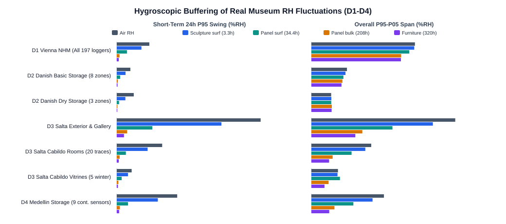
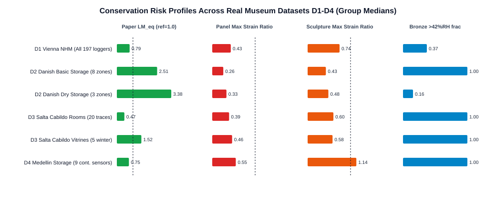

# S2.4 公开实测馆内气候上的文物响应与损伤评估汇总

> **定位**：对应 `docs/PLAN_ISCIENCE.md` 论文 Results 第 2 节（“文物响应滤掉了短期波动：真实馆内气候下的损伤评估”）。按 `docs/DATASETS.md` 严守：**公开数据集用于检验文物响应与损伤模型在真实微气候下的物理行为，不将其称作对本文建筑模型的校准**。

## 1. 复现元信息与范围界定

- **评估脚本**：[eval_real_traces.py](../../scripts/v2/eval_real_traces.py)
- **基础提交号（运行基线）**：`2512957`（含 `docs/DATASETS.md` 作者修订）
- **配置文件**：[objects.yaml](../../configs/objects.yaml)（SHA-256: `87edb7a69e9e5af3aa8a15bb6700ff5a84a2733f189f144dcab8f54868794208`）
- **随机种子**：`null`（全确定性实测序列评估）
- **完整数值结果**：[real_traces_summary.json](./real_traces_summary.json)（含全部 249 条清洗后轨迹的逐条明细及双初值敏感性结果）
- **图表产出**：
  - [rh_fluctuation_attenuation.svg](./rh_fluctuation_attenuation.svg)
  - [damage_risk_summary.svg](./damage_risk_summary.svg)
- **纳入与排除数据集（共评估 249 条实测轨迹，合计约 1,790,998 序列小时）**：
  - **D1（可用）**：维也纳自然史博物馆微气候（`brimblecombe2025vienna`，`197` 台去重拼接记录仪，`1,434,644` 小时，统一重采样至 `0.25 h`）。按 `docs/DATASETS.md` 去除 `14233546/NH082.csv` 重复写入文件（保留 `14233508/NH082.csv`），并按时间拼接 `14233546/NH083.csv` 与 `14233508/NH083.csv`。
  - **D2（可用）**：丹麦低能耗博物馆库房（`ryhlsvendsen2012storage`，`11` 个室内库区：`8` 个 Basic 库房 + `3` 个 Dry 干燥库房，`345,035.17` 小时，分别在 `1/6 h`、`0.5 h`、`1.0 h` 均匀网格评估；其中 `03_vejle-A` 2011–2013 延伸段按 `3.0 h` 分段）。
  - **D3（可用，限短期日波动对照）**：阿根廷萨尔塔 Cabildo 历史博物馆（`geasalim2024cabildo`，`INVIERNO` 约 `14.8` 天 + `VERANO` 约 `19.9` 天，共 `29` 条通道、`10,227.25` 室内 + `1,665.5` 室外/回廊序列小时，`0.25 h` 网格）。自动跳过 `VERANO` 工作表第 4–6 行无时标的 `MIN/MEAN/MAX` 汇总行；遵循 `docs/DATASETS.md` 不外推 ≥30 天季节滑动指标。
  - **D4（部分可用，仅 `Museum_Nov2019/`）**：哥伦比亚麦德林 De La Salle 自然科学博物馆库房（`boterovalencia2022dataset`，2019-11 整月 31 天，由 12 台经 ONAC 认可实验室 Fluke 2626-H 校准的消费级小米 Xiaomi Mijia `LYWSDCGQ/01ZM` 温湿度计采集，标称精度 `±0.3 °C`、`±3% RH`，重采样至 `0.25 h`；以 `9` 台连续探头为主统计、`12` 台全集作对照；**严格排除 `LSCR_Oct2019/` 非受控机器人实验室子集**）。
  - **D5（不用）**：因缺乏明确研究再分发许可，严格排除。

---

## 2. 核心发现一：空气 RH 波动幅度 vs 文物感受到的波动幅度

下表给出各数据集及功能分区的**组内中位数**对比。`24h P95 Swing` 反映短周期昼夜/运行波动；`Span (P95–P05)` 与标准差比 `STD 穿透比` 反映包含季节迁移在内的总体变化跨度；括号内为穿透比（`对象幅度 / 空气幅度`）。

| 数据集与分组（轨迹数） | 空气 `24h P95` 波动 (%RH) | 雕塑表层 `3.33h` `24h P95` (穿透比) | 木板画表层 `34.4h` `24h P95` (穿透比) | 木板画整体 `208h` `24h P95` (穿透比) | 漆木家具 `320h` `24h P95` (穿透比) | 空气 `P95–P05` 跨度 (%RH) | 木板画整体 `P95–P05` 穿透比 | 木板画整体 `STD` 穿透比 |
|---|---|---|---|---|---|---|---|---|
| D1 维也纳 NHM 展区 ex-K (`n=175`) | 9.20 | 6.91 (`0.752`) | 2.81 (`0.305`) | 0.77 (`0.083`) | 0.54 (`0.059`) | 25.40 | `0.872` | `0.922` |
| D1 维也纳 NHM 地下室 K (`n=22`) | 10.63 | 8.65 (`0.814`) | 3.88 (`0.365`) | 1.08 (`0.102`) | 0.74 (`0.069`) | 33.91 | `0.846` | `0.907` |
| D2 丹麦 Basic 库房 (`n=8`) | 4.00 | 2.59 (`0.646`) | 0.99 (`0.247`) | 0.32 (`0.079`) | 0.23 (`0.058`) | 9.00 | `0.873` | `0.896` |
| D2 丹麦 Dry 干燥库房 (`n=3`) | 5.00 | 2.54 (`0.508`) | 0.67 (`0.133`) | 0.19 (`0.037`) | 0.14 (`0.029`) | 5.00 | `1.033`* | `0.956` |
| D3 萨尔塔 室外与回廊 (`n=4`) | 42.41 | 30.85 (`0.727`) | 10.48 (`0.247`) | 3.05 (`0.072`) | 2.12 (`0.050`) | 36.40 | `0.354` | `0.389` |
| D3 萨尔塔 室内展厅 (`n=20`) | 13.39 | 9.09 (`0.679`) | 2.68 (`0.200`) | 0.85 (`0.063`) | 0.59 (`0.044`) | 15.14 | `0.356` | `0.390` |
| D3 萨尔塔 展柜 (`n=5`, 冬) | 4.39 | 3.31 (`0.755`) | 1.45 (`0.329`) | 0.47 (`0.107`) | 0.35 (`0.079`) | 6.72 | `0.647` | `0.529` |
| D4 麦德林库房 (`n=9` 连续) | 17.82 | 12.11 (`0.679`) | 3.30 (`0.185`) | 0.92 (`0.052`) | 0.69 (`0.039`) | 18.36 | `0.317` | `0.327` |

> **\*注（关于 `P95–P05` 穿透比局部略大于 1 的数值原因）**：D2 原始空气 RH 以**整数 `%RH`** 离散记录。在 `D2 Dry` 等波动较窄的库区（如 `06_vejle-B` 跨度仅 `4 %RH`、`08_randers-dry` 仅 `5 %RH`），空气经验分位数 `Q95 - Q05` 受 `1 %RH` 整数量化阶跃限制，而连续低通滤波输出为实数值（`06_vejle-B` `4.13 vs 4.0`、`08_randers-dry` `5.76 vs 5.0`，而跨度较大的 `02_ribe-dry` 为 `14.96 vs 15.0`，穿透比 `0.997`）。若以不受整数量化阶跃影响的标准差检验，`D2 Dry` 全部分区严格满足 `std_bulk / std_air < 1.0`（`0.931–0.967`，中位 `0.956`）。
>
> **物理规律总结**：
> 1. **日内短周期波动（`24h P95`）被强烈过滤**：在 D1–D4 实测微气候下，`wooden_sculpture` 表层（$\tau = 3.33\text{ h}$）仍透过 `50.8%–81.4%` 的日波动；但 `panel_painting` 表层（$\tau = 34.4\text{ h}$）已将日波动衰减至 `13.3%–36.5%`，其整体（$\tau = 208\text{ h}$）与 `wooden_furniture`（$\tau = 320\text{ h}$）分别降至 **`3.7%–10.7%`** 与 **`2.9%–7.9%`**。
> 2. **季节性慢变穿透进入木质整体**：在跨年序列 D1 与 D2 中，虽然日内波动被显著滤除，但历时数月的季节干湿迁移使木板画整体总标准差仍保留空气的 **`89.6%–95.6%`**（`P95–P05` 跨度穿透达 **`84.6%–87.3%`**，其中整数记录且跨度仅 4–5% 的 D2 Dry 因分位量化显现 `1.033`），说明控制策略必须区分“可容忍的短周期高频波动”与“需约束的低频季节偏移”。

---

## 3. 核心发现二：四类损伤机制汇总与初值敏感性检验

### 3.1 四类损伤指标汇总（默认 `first_sample` 初值与全口径对照）

下表均报告组内**中位数**（及关键极值区间 `[min..max]`）。机械峰值报告精确峰值应变比 $\max_t |\varepsilon_t| / \varepsilon_{\mathrm{yield}}$（`1.0` 对应屈服应变 `0.004`），括号前为 `first_sample` 默认值；跨初值对比见 **3.2 节**。

| 数据集与分组 | 纸质 $LM_{\text{eq}}$ | 纸质霉菌萌发率 (`yr⁻¹`, [max]) | 木雕峰值应变比 | 木板画峰值应变比 | 家具峰值应变比 | 青铜 `>42% RH` 占比 | 青铜 `>65% RH` 占比 |
|---|---|---|---|---|---|---|---|
| D1 展区 ex-K (`n=175`) | **0.790** `[0.48..1.97]` | 0.00 `[0.019]` | 0.704 `[0.26..2.32]` | 0.415 `[0.10..1.12]` | 0.778 `[0.11..1.64]` | 0.363 `[0..0.98]` | 0.000 `[0..0.062]` |
| D1 地下室 K (`n=22`) | 0.873 `[0.54..1.12]` | 0.00 `[4.202]` | **1.051** `[0.63..3.53]` | 0.699 `[0.32..2.13]` | **1.067** `[0.55..2.07]` | 0.668 `[0.11..0.95]` | 0.018 `[0..0.467]` |
| D2 Basic 库房 (`n=8`) | **2.505** `[1.42..2.89]` | **0.000** `[0.000]` | 0.426 `[0.22..0.56]` | 0.258 `[0.15..0.40]` | 0.313 `[0.12..0.93]` | 1.000 `[0.91..1.00]` | 0.000 `[0..0.015]` |
| D2 Dry 库房 (`n=3`) | **3.380** `[1.87..3.45]` | **0.000** `[0.000]` | 0.484 `[0.36..0.72]` | 0.331 `[0.24..0.53]` | 0.457 `[0.43..0.53]` | **0.156** `[0.004..0.22]` | 0.000 `[0.000]` |
| D3 展厅 (冬/夏 `n=20`) | 0.467 `[0.33..1.45]` | 0.000 `[0.001]` | 0.601 `[0.28..0.91]` | 0.393 `[0.19..0.74]` | 0.237 `[0.14..0.58]` | 1.000 `[0.66..1.00]` | 0.113 `[0..1.00]` |
| D3 展柜 (冬 `n=5`) | 1.522 `[1.17..1.58]` | 0.000 `[23.50]` | 0.581 `[0.37..0.99]` | 0.463 `[0.26..0.91]` | 0.365 `[0.30..1.68]` | 1.000 `[1.00..1.00]` | 0.441 `[0.23..1.00]` |
| D4 库房 (`n=9` 连续) | **0.751** `[0.68..0.91]` | 0.002 `[2.639]` | **1.136** `[0.42..1.85]` | 0.549 `[0.27..1.17]` | 0.239 `[0.10..0.97]` | 1.000 `[0.998..1.00]` | 0.177 `[0.008..0.63]` |

### 3.2 初值敏感性检查（段首平衡 `first_sample` vs 段内均值初始化 `segment_mean`）

由于物体整体时间常数长达 `120–320 h`，对于短期序列（D3 15–20 d、D4 31 d）或断档后重起算段，若首样本恰好处于极端偏离位置，段首瞬态会拉高峰值应变。下表对全部主要组别及此前关注的关键极值做双初值对比：

| 对比对象（分组或典型轨迹） | 藏品与指标 | 初值偏差 $\Delta \mathrm{RH}_0$ (%RH) | `first_sample`（段首平衡） | `segment_mean`（段均值平衡） | 越界结论（>1.0）是否改变 |
|---|---|---|---|---|---|
| **D4 麦德林库房 (`n=9` 连续)** | **木雕中位峰值应变比** | — | **1.136** `[0.423..1.849]` | **1.142** `[0.412..1.728]` | **不改变（均 > 1.0）** |
| D4 点位 `234132342d58` | 木雕峰值应变比 | 15.18 | 1.849 | 1.728 | 不改变（均 > 1.0） |
| D4 点位 `234132342d58` | 木板画峰值应变比 | 15.18 | **1.170** | **0.866** | **改变（瞬态导致，撤回超限宣称）** |
| **D1 地下室 `floor_K` (`n=22`)** | **家具中位峰值应变比** | — | **1.067** `[0.554..2.075]` | **1.031** `[0.111..2.075]` | **不改变（均 > 1.0）** |
| **D1 地下室 `floor_K` (`n=22`)** | 木雕中位峰值应变比 | — | **1.051** `[0.628..3.527]` | **1.144** `[0.372..3.527]` | **不改变（均 > 1.0）** |
| D1 地下室 `NH061` (`K 165 F`) | 木板画 / 木雕应变比 | 0.03 | 2.126 / 3.527 | 2.125 / 3.527 | 不改变（均显著 > 1.0） |
| D1 展区 `NH191` (`TP 229 N`) | 木板画峰值应变比 | 11.78 | 1.123 | 1.123 | 不改变（均 > 1.0） |
| **D3 夏季回廊 `PB-Galería (S12)`** | **木板画峰值应变比** | 8.65 | **1.066** | **0.835** | **改变（瞬态导致，撤回超限宣称）** |
| D3 室内展厅 (`n=20`) | 木板画中位峰值应变比 | — | 0.393 `[0.190..0.740]` | 0.288 `[0.076..0.583]` | 不改变（均 < 1.0） |
| D2 丹麦 Basic / Dry 库房 | 木板画 / 木雕 / 家具 | — | 0.258 / 0.426 / 0.313 | 0.258 / 0.425 / 0.284 | 不改变（全 11 区均 < 1.0） |

> **敏感性筛查裁决**：D3 夏季回廊 `S12`（`1.066 -> 0.835`）与 D4 `234132342d58` 木板画（`1.170 -> 0.866`）的 `>1.0` 仅来自首样本偏离均值的初值瞬态，**不写入主结论**；而 D4 连续探头中位 `wooden_sculpture`（`1.136 / 1.142`）、D1 地下室中位 `wooden_furniture`（`1.067 / 1.031`）与 `wooden_sculpture`（`1.051 / 1.144`）、以及 D1 个别高风险测点（`NH061`、`NH043`、`NH191`）在两种初始化下均稳健成立。

### 3.3 D2 丹麦低能耗博物馆库房 11 区逐区结果明细

| 文件编号与库区 | 类型 | 年均温 (°C) | 均值 RH (%) | `P95–P05` (%RH) | `24h P95` (%RH) | 纸质 $LM_{\text{eq}}$ | 木板画应变比 (`first`/`mean`) | 家具应变比 (`first`/`mean`) | 青铜 `>42%` | 青铜 `>35%` | 替换毛刺数 |
|---|---|---|---|---|---|---|---|---|---|---|---|
| `01` Ribe Basic | Basic | 11.9 | 55.1 | 9.0 | 2.0 | 2.69 | 0.398 / 0.398 | 0.926 / 0.926 | 1.000 | 1.000 | 0 |
| `02` Ribe Dry | Dry | 17.5 | 38.6 | 15.0 | 3.0 | 1.87 | 0.528 / 0.528 | 0.433 / 0.433 | 0.217 | 0.840 | 0 |
| `03` Vejle A | Basic | 11.7 | 51.7 | 6.0 | 4.0 | 2.87 | 0.213 / 0.213 | 0.345 / 0.345 | 1.000 | 1.000 | 2 |
| `04` Vejle C | Basic | 11.7 | 51.4 | 4.0 | 4.0 | 2.89 | 0.261 / 0.261 | 0.151 / 0.151 | 1.000 | 1.000 | 4 |
| `05` Vejle D | Basic | 11.9 | 50.7 | 4.0 | 4.0 | 2.87 | 0.256 / 0.256 | 0.117 / 0.117 | 1.000 | 1.000 | 0 |
| `06` Vejle B | Dry | 12.8 | 41.1 | 4.0 | 5.0 | 3.38 | 0.239 / 0.235 | 0.457 / 0.344 | 0.156 | 1.000 | 1 |
| `07` Randers Basic | Basic | 13.0 | 51.7 | 9.0 | 6.5 | 2.32 | 0.150 / 0.150 | 0.169 / 0.169 | 1.000 | 1.000 | 0 |
| `08` Randers Dry | Dry | 14.5 | 31.5 | 5.0 | 8.5 | 3.45 | 0.331 / 0.152 | 0.527 / 0.103 | 0.004 | 0.049 | 0 |
| `09` Ørholm P1 | Basic | 13.9 | 55.4 | 12.0 | 3.0 | 1.67 | 0.251 / 0.251 | 0.414 / 0.268 | 0.999 | 1.000 | 0 |
| `10` Ørholm P2 | Basic | 15.6 | 51.2 | 15.0 | 3.0 | 1.42 | 0.292 / 0.292 | 0.328 / 0.301 | 0.950 | 0.998 | 0 |
| `11` Ørholm P3 | Basic | 15.5 | 49.5 | 14.0 | 4.0 | 1.50 | 0.305 / 0.305 | 0.297 / 0.252 | 0.912 | 0.998 | 0 |

---

## 4. 与原数据集论文/报告定性结论的逐一对照（均注出处，严格区分文献原话与本文实测计算）

### 4.1 D1 · 维也纳自然史博物馆（`brimblecombe2025vienna`, *Heritage* 2025, 8(4), 124）
> **文献核实范围**：本节引用依据已直接核对的 OpenAlex 公开摘要原文（Abstract；全文各章节细表尚待 S5.1 复核）。

- **原论文 Abstract 明确陈述（对照一致部分）**：
  1. 展厅最暖与冬季极度干燥：Abstract 指出 `"Daily mean temperatures showed exhibition halls typically had the warmest rooms. This was due to the heating in winter and open windows on summer days. The halls can become even hotter than the outside temperature."` 且 `"In winter, most areas of the museum were very dry, as heating lowered the relative humidity, typically to 25–35% for the coldest season."` **本文实测计算显示**，197 台去重记录仪中上层展区（`ex-K`, `n=175`）均值 RH 中位数仅 `38.3%`，所有测点最低 RH 分布达 `7.5%–39.6%`（冬季极度干燥特征与原文一致），同时 `floor_HP` 与 `floor_O1` 均值温中位数达 `24.8 °C` 与 `24.5 °C`，高于较凉地下空间 `floor_K`（`20.6 °C`）。
  2. 总体表现尚可：Abstract 总结 `"While there was little apparent damage to the collection, at times, the museum had an extreme indoor climate: very hot in the summer and dry in the winter."` **本文实测计算显示**，上层展区（`ex-K`）中位 `panel_painting` 峰值应变比在两种初值下均为 `0.415 / 0.430`（屈服超限占比中位数 `0.000`），且绝大多数上层测点霉菌萌发指数为 `0.00`，在机械与霉菌维度总体处于安全区；但本文模型计算同时显示热干条件导致展区纸质中位 $LM_{\text{eq}} = 0.790$（`< 1.0`）。
- **文献差异说明与本文实测补充发现**：
  1. 空间均匀性与局部异常极值：Abstract 指出 `"There was little difference between sunny and shaded parts of the building or adjacent offices, corridors and depots."` 且专门冷库 `"maintained 10 °C and relative humidity ~50%, but this had become increasingly difficult in hot summers."` **本文实测计算发现**，从楼层总体看确有 `floor_K`（22 台地下库房/地下室测点，均值温中位 `20.6 °C`，不属于上述 10 °C 专冷库）均值 RH 中位数（`47.4%`）比上层展区高 9.2 个百分点，且其中少数局部湿点跨初值一致超限：例如 `NH043 (K 110 F)` 最高 `82.0% RH`、年化萌发 `4.20/yr`、家具应变比 `2.075`，`NH061 (K 165 F)` 最高 `87.0% RH`、木板画应变比 `2.126 / 2.125`、萌发 `2.73/yr`，阁楼点 `NH191 (TP 229 N)` 达 `1.123 / 1.123`；此外展区中位 `36.3%`（地下室 `66.8%`）小时超过青铜 `42% RH` 氯化物阈值。

### 4.2 D2 · 丹麦低能耗博物馆库房（`ryhlsvendsen2012storage`, 终期报告 PDF 原文直接核对）
> **文献核实范围**：直接读取数据仓库自带终期报告 `Report_low-energy-museum-storage-buildings.pdf`（Ch. 1–6，具体页码与表号如下）。

- **与原报告结论高度一致部分**：
  1. 被动调温 + 机械除湿策略验证：报告 `Ch. 1, p. 2` 写明 `"Both of the new stores are regulated toward a steady relative humidity set point (e.g., 50 % RH) while the temperature is allowed to vary over the year (no heating for basic storage environment, and a few degrees of wintertime ‘conservation heating’ for dry environments)."`，`Sec. 2.1, p. 4` 给出 `"Only the storage buildings which were designed for an annual temperature profile of always <18 °C reached a TWPI above 100 (see Fig. 2.1)"` 与 `"the un-heated buildings are the most economical buildings to run"`（各馆年均温、RH 范围、TWPI 与相对能耗汇总于 `Table 2.1, p. 8`，例如 Ribe/Vejle Basic TWPI=`115`、`1.5 kWh/m³y`，Randers Basic `90`、`3 kWh/m³y`，Vejle/Randers Dry `130`、`4 / 9 kWh/m³y`，而带供暖非制冷 HVAC 的 Ørholm Hall P 仅 TWPI=`70`）。**本文实测计算显示**，采用相同的化学反应速率物理方向（`Sec. 2.1, p. 4` 注明 TWPI 亦基于反应速率随温湿度变化），8 个 Basic 库房纸质 $LM_{\text{eq}}$ 达 `1.42–2.89`（其中温度较低的 Ribe/Vejle 为 `2.69–2.89`，高于 Ørholm P1–P3 的 `1.42–1.67`，与报告 `Table 2.1` 及 `Sec. 6.5.1, p. 47` 所示 TWPI 排序完全一致），3 个 Dry 库房达 `1.87–3.45`；同时 **本文实测计算显示**全 11 区霉菌萌发均为 `0.000`，所有库区木板画峰值应变比在两种初值下均仅 `0.150–0.528`（`< 1.0`）。
  2. Dry 库房干湿度波动特性：报告 `Sec. 5.5.2, p. 37` 指出 Randers Dry `"on a short term basis sudden RH variations of up to 5% occur when the dehumidifier starts up"`，**本文实测计算**检出 `08 Randers Dry` 的 `24h P95` 波动为 `8.5% RH`，高于 Randers Basic（`6.5% RH`）；`Sec. 3.5.1, pp. 13–14` 记录 Ribe Basic 于 2008 年底由 `55% RH` 调整至 `50% RH`，对应 **本文实测计算** 中 `01 Ribe Basic` 的慢速阶跃与家具应变比（`0.926`，全 Basic 最高但仍 `< 1.0`）；`Sec. 6.5.1, p. 47` 记载 Ørholm Hall P 维持 `50%–60% RH`（峰值 `65% RH`）与 2010 年初机械故障降至 `45% RH`，与本文跨度较宽（`12%–15% RH` `P95–P05`）吻合。
- **本文实测补充发现（原报告未专门评估的机制与毛刺审计）**：
  1. 青铜与水膜临界湿度：**本文实测计算显示**，Dry 库房将 `>42% RH` 占比由 Basic 库房的 `91.2%–100.0%` 压低至 `0.44%–21.7%`，`08 Randers Dry` 更将 `>35% RH` 压至 `4.88%`；`01 Ribe Basic` 因存在最高 `73.0% RH` 记录，有 `1.52%` 时段高于 `65% RH`。
  2. 单点毛刺审计：`03_vejle-A`（2 点，如同时间戳 `2008-09-01 08:40` 存在 `49.8°C / 83%` 与正常记录并存）、`04_vejle-C`（4 点）与 `06_vejle-B`（1 点）存在孤立单步遥测错码，报告 `Sec. 4.5.1` 等提及偶发系统停机，本文已于前处理中自动替换并登记全部 7 个单步毛刺点。

### 4.3 D3 · 阿根廷萨尔塔历史博物馆 Cabildo（`geasalim2024cabildo`, Zenodo `13685667`）
> **文献核实范围**：已直接调取 Zenodo 记录 `13685667` 元数据原文及 `MedicionesCabildo.xlsx` 数据。按 `docs/DATASETS.md`，“检索未见绑定的正式期刊论文”。

- **原数据集记录陈述范围**：Zenodo 记录说明仅交代 2019 年冬、夏两季各约 15 天（15 min 间隔）利用经标定 HOBO U12-012 记录仪（`±0.35 °C`, `±2.5% RH`）监测各展厅、展柜与室外/回廊温湿度（`"a sensor was installed in the building's galleries in all cases to record outdoor temperature and relative humidity data, allowing for a comparative analysis between indoor and outdoor conditions"`），**本身并未给出对波动阻尼幅度或文物风险的定性结论**。
- **本文实测数据分析显示**：
  1. 建筑与展柜逐级衰减日波动：冬季室外 `24h P95` 波动 `53.0% RH` $\rightarrow$ 半室外回廊 `PB-Galería (S8)` `24.3%` $\rightarrow$ 展厅（9 通道）中位 `12.1%`（`3.8%–13.5%`）$\rightarrow$ 展柜（5 个，冬季）中位 `4.4%`（`2.8%–9.7%`）；夏季室外 `59.0%` $\rightarrow$ `PB-Galería (S12)` `31.8%` $\rightarrow$ 展厅（11 通道）中位 `18.8%`（`10.5%–32.5%`）。叠加文物吸湿滞后，室内展厅 `panel_painting` 表层日波动降至空气的 `20.0%`，其机械峰值应变比在两种初值下均为安全区（`first_sample`: `0.190–0.740`；`segment_mean`: `0.076–0.583`；第 3.2 节已查明此前 `VERANO S12` 回廊的 `1.066` 在 `segment_mean` 下降至 `0.835`，故不将其归为越界）。
  2. 冬季展柜高湿与季节老化差异：**本文实测计算显示**，冬季 5 个展柜虽日波动很小（`4.4%`），但均值 RH 高达 `64.7%`（最高 `83.9%`），个别展柜在冬季 15 天内即累积萌发进度近临界值（折算年化最高达 `23.5/yr`），且全部室内测点 `>42% RH` 占 `65.7%–100%`；夏季室内暖湿使纸质 20 天等效 $LM_{\text{eq}}$ 降至 `0.33–0.49`，冬季升至 `1.07–1.45`。

### 4.4 D4 · 哥伦比亚麦德林 De La Salle 博物馆库房（`boterovalencia2022dataset`, *Data* 2022, 7(6), 81）
> **文献核实范围**：已核对 OpenAlex 收录原文 Abstract、仓库 `Museum_Nov2019/description_table.png`（Table 2 采样清单）及 `docs/DATASETS.md`（引该文第 2 节校准说明）。传感器为经 ONAC 认可计量实验室对照 Fluke 2626-H 校准的消费级小米 Xiaomi Mijia（`LYWSDCGQ/01ZM` / `MJ_HT_V1`，厂商标称精度 `±0.3 °C`、`±3% RH`）。因原文主要系 IoT 数据发布论文、未计算文物保护指标，以下全部现象限定为**在该传感器实测数据与本文一阶模型下的数据观测结果**：

- **数据观测结果显示**：
  1. 点位差异与慢响应滤波：**在小米 Mijia 校准探头实测数据（连续 9 台 `Museum_Nov2019/`）与本文模型下，数据显示**库内不同测点温湿度均值与跨度差异明显（均值温度 `17.9–21.6 °C`、RH `56.7%–67.2%`、`P95–P05` 从 `8.6%` 到 `20.8% RH`）；同时，高频 `24h P95` 空气波动中位数高达 **`17.8% RH`**，经 `panel_painting`（34.4 h 表层 / 208 h 整体）衰减至 `18.5% / 5.2%`，经 `wooden_furniture`（320 h）衰减至 `3.9%`（即家具对该频率波动的响应幅度极小）。
  2. 短周期振荡对快表层与生物/金属指标的含义：**在上述消费级传感器测量精度与 31 天观测窗口前提下，数据显示**连续 9 探头 `wooden_sculpture`（$\tau_{\text{surf}} = 3.33\text{ h}$）在两种初始化下的中位峰值应变比均超过 `1.0`（`1.136 / 1.142`；最大点 `234132342d58` 为 `1.849 / 1.728`）；而此前在 `first_sample` 下出现超屈服的 `234132342d58` `panel_painting`（`1.170`），在 `segment_mean` 下降至 `0.866 < 1.0`，故不能认定板画在该库房越过屈服线。此外，实测数据显示连续 9 探头在 31 天内纸质 $LM_{\text{eq}}$ 为 `0.68–0.91`（中位 `0.751`），`>42% RH` 占 `99.8%–100%`（`>65% RH` 占 `0.8%–62.6%`），高湿点 `234132342d58` 31 天霉菌进度达 `0.224`（折算 `2.64/yr`）。这提示即使均值在常见范围内，库房内频繁的高湿脉冲（若属实测物理波动而非局部结露/测点扰动）主要威胁短时间常数表面与含氯金属。

---

## 5. 可视化汇总

---

## 6. 数据清洗、毛刺审计与已知局限

1. **网格化与缺测分段策略**：`clean_and_regularize_series` 对齐各自均匀时间步（`0.25 h` / `1/6 h` / `0.5 h` / `1.0 h`）做桶平均，仅对 `<= 6 h` 的短时丢点作线性插值；对长期停测（如 D1 5 个 822–3737 h 缺口、D2 Vejle 71–274 h 停电、Randers 873 h 缺测、Ørholm P2/P3 698 h 缺测及 D4 3 台断连探头 19–24 h 中断）直接按连续段切分并分段运行 `compute_object_response`，绝不跨断档插值造数。
2. **孤立单点遥测毛刺（共替换 8 个单点）**：
   - **D1**：全 197 台（约 574 万步）仅检出 1 个孤立毛刺点；**D2**：`03_vejle-A` 2 点、`04_vejle-C` 4 点、`06_vejle-B` 1 点；**D3 / D4**：均 `0` 点。
3. **已知局限与口径限制**：
   - **`wooden_furniture` 参考均值局限**：`mode="acclimatized"` 在本评估中使用各自完整观测期均值 $\overline{\mathrm{RH}}$ 作为平衡基准。对跨年多季数据集（D1、D2），该均值近似年平均适应状态；但 **D3（每季仅 14.8–19.9 天）与 D4（仅 31 天）观测期远短于完整年周期，所得参考均值仅代表各自短期观测窗平均湿度，而非真正意义上的“长期历史适应均值”**，故 D3/D4 中的家具应变指标仅供短期波动相对幅度的敏感性对照，不可外推为跨年老化或开裂判断。
   - **初值敏感性**：已通过第 3.2 节双初值对比排除短序列首样本瞬态假阳性。
   - **传感器与无室外数据局限**：D4 采用消费级小米 Mijia 传感器（标称 `±3% RH`，虽经 ONAC 实验室校准仍应谨慎解读局部极端值）；D1 `NH002..NH220` 与 D4 均无同期室外气测（按 `DATASETS.md` 严禁将 D1 贴地 `Ext` 列作室外气象）；D3 仅覆盖两季短期战役，不外推 ≥30 天指标。
